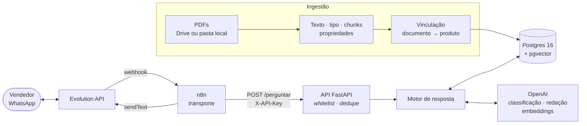
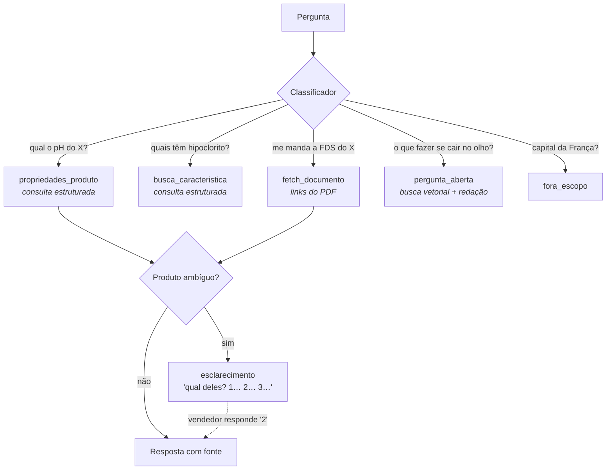
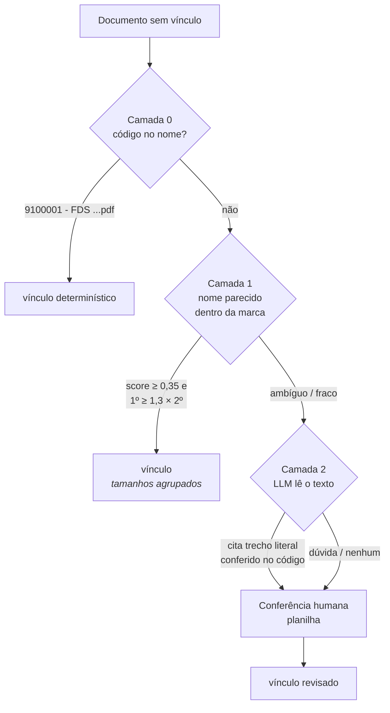

# Bot de Fichas Técnicas

Assistente de WhatsApp para **vendedores de uma revenda de produtos de
limpeza e higiene**. O vendedor pergunta em linguagem natural e o bot
responde com base nas fichas técnicas (FT) e fichas de segurança (FDS)
dos fabricantes, citando a fonte e mandando o PDF quando pedido.

```
Vendedor: qual o pH da água sanitária Limpax?
Bot:      AGUA SANITARIA LIMPAX 1L (LIMPAX) — código 9000001:
          - pH: 10 - 13
          Conforme FDS de Agua Sanitaria Limpax.
```

> **Este é um repositório de exemplo.** O sistema roda para um cliente;
> aqui, catálogo, marcas, empresas, documentos e códigos de produto são
> **inventados** (pasta `demo/`). O código, a arquitetura e as decisões
> são os reais.

[](https://github.com/Renan-Maciel-Santos/bot-fichas-tecnicas/actions/workflows/testes.yml)

---

## Rodar a demo (≈ 5 minutos)

Precisa de Docker e de uma chave da OpenAI. A carga da demo custa alguns
centavos de dólar.

```bash
git clone https://github.com/Renan-Maciel-Santos/bot-fichas-tecnicas.git
cd bot-fichas-tecnicas

deploy/gerar_env.sh          # cria o .env com todas as senhas geradas
nano .env                    # preencha OPENAI_API_KEY

deploy/instalar.sh           # sobe Postgres, API, n8n e Evolution; schema vazio
demo/carregar_demo.sh        # catálogo + 10 PDFs fictícios pelo pipeline real

demo/perguntar.sh "qual o pH da agua sanitaria limpax?"
demo/perguntar.sh "me manda a FDS do desinfetante de eucalipto"
demo/perguntar.sh "o que fazer se o alcool gel cair no olho?"

demo/perguntar.sh "me manda a FDS do desinfetante limpax"   # 3 fragrâncias: pergunta qual
demo/perguntar.sh "3"                                       # e entende a escolha
```

O `perguntar.sh` chama a API como o n8n chamaria vindo do WhatsApp. Ligar
um número de WhatsApp de verdade está em [`docs/DEPLOY_VPS.md`](docs/DEPLOY_VPS.md)
(passos 7 a 9).

---

## Arquitetura



**O n8n só transporta.** Quem pode perguntar (whitelist), mensagem
repetida (dedupe por `message_id`) e o que responder vivem na API, para
que trocar de canal não mova as regras de lugar.

Tudo sobe pelo `docker-compose.yml`: Postgres, API, Evolution e n8n,
**cada um com seu database e sua role**, sem privilégio cruzado:

| Database | Role | Conteúdo |
|---|---|---|
| `bot_fichas` | `bot_app` (só lê o acervo) · `botuser` (manutenção) | produtos, documentos, chunks, consultas |
| `n8n_bot` | `n8n_user` | fluxo, credenciais, execuções |
| `evolution_bot` | `evolution_user` | instância do WhatsApp |

### O motor de resposta

Um classificador (LLM com saída estruturada) decide a intenção; cada
intenção tem um caminho próprio, e **só a pergunta aberta passa por RAG**:



- **Nunca responde sem fonte.** Toda resposta cita o documento; sem
  documento, diz que não encontrou.
- **Ambiguidade vira pergunta.** "Água sanitária" com três marcas no
  catálogo devolve uma lista numerada; o estado da conversa (15 min)
  entende o "2" que vem depois.
- **Desconfiança explícita.** Toda resposta lembra o vendedor de conferir
  informação crítica na ficha original antes de repassar ao cliente.

### Ingestão e vinculação em camadas

O problema central não é o LLM: é saber **a que produto cada PDF
pertence**. Os nomes de arquivo dos fornecedores são inconsistentes, e
vincular errado manda a ficha de segurança do produto errado.



O que cada camada ensinou, medido contra um gabarito rotulado pelo
especialista do cliente (`scripts/eval_camada1.py`, `scripts/eval_camada2.py`):

- **Camada 1 (trigrama).** O gabarito aceitava afrouxar o limiar e dobrar
  a cobertura sem erro. Uma simulação no banco inteiro, fora da amostra,
  mostrou o contrário: abaixo de 0,35 o trigrama casa "Limpador
  Perfumado" com "Álcool Perfumado" — compara letras, não sabe que gel e
  líquido são produtos diferentes. O limiar ficou; o ganho veio de
  **agrupar embalagens** (a FISPQ sem tamanho no nome vale para 500 ML e
  1 L) sem agrupar o que define o produto (70x50 cm, 0,025 mm, 70º).
- **Camada 2 (LLM).** Recebe o catálogo da marca como **lista fechada** e
  precisa citar, para cada produto, um **trecho literal** do PDF, que o
  código confere; qualquer desvio vira "dúvida". Com isso, a precisão
  foi de 74% (`gpt-4o-mini`) a 90–92% (`gpt-5.5`).
- **Nada do LLM chega sozinho ao vendedor.** O bot envia todo documento
  vinculado, então os vínculos da Camada 2 vão para uma planilha de
  conferência (`scripts/conferencia_llm.py`) e só entram no banco os
  marcados como corretos.

A demo exercita todas as camadas: código no nome, nome parecido,
tamanhos agrupados, uma FDS que só o texto revela valer para três
fragrâncias, um alvará filtrado e uma marca fora do catálogo.

---

## Decisões de engenharia

| Decisão | Por quê |
|---|---|
| **Role de privilégio mínimo** (`bot_app`) para a API | Ela lê o acervo e grava só o log de consultas; ingestão e manutenção rodam como `botuser`. |
| **Idempotência por `message_id`** | O WhatsApp reenvia webhooks; a API registra antes de chamar o LLM e libera se o motor falhar, para o reenvio valer. |
| **Ordem das barreiras** na API | Whitelist e dedupe são consultas locais e baratas; número não autorizado nunca gasta cota da OpenAI. |
| **Soft delete** em documentos e produtos | `revogado_em` e `substituido_por_id` em vez de `DELETE`; nenhuma busca do bot devolve documento revogado. |
| **Portas só no loopback** | Numa VPS o Docker passa por cima do firewall; nada fica exposto, e os painéis abrem por túnel SSH. |
| **Imagens pinadas** (n8n, Evolution) | Um `pull` silencioso troca a versão e roda migrations sozinho. |
| **`N8N_ENCRYPTION_KEY` declarada** | Sem ela o n8n esconde uma chave autogerada no volume: perder o volume perde as credenciais. |
| **Gabaritos versionados** (`tests/golden/`) | Mudança de limiar, prompt ou modelo passa por um eval antes; nada é calibrado no olho. |
| **CI com chave da OpenAI falsa** | Os testes simulam o LLM; um teste que chame a API de verdade falha no CI em vez de gastar. |

---

## Estrutura

```
src/
  api/            FastAPI: rota /perguntar, whitelist, dedupe
  query/          motor: classificador, buscas estruturada e vetorial,
                  contexto de conversa, citação, redação
  ingestion/      PDFs (Drive ou pasta local) e catálogo (planilha)
  link_documents.py      vinculação, Camadas 0 e 1
  link_llm.py            vinculação, Camada 2
  process_chunks.py      chunks + embeddings
  process_extraction.py  propriedades estruturadas (pH, ativo, CAS…)
db/
  migrations/     schema versionado
  provisioning/   databases, roles e grants
deploy/           instalar, gerar .env, exportar acervo, backup
demo/             catálogo e PDFs fictícios + scripts da demo
n8n/workflows/    fluxo WhatsApp → API → WhatsApp
scripts/          evals, conferências com o cliente, setup do WhatsApp
tests/            unitários e de integração (banco real, rollback)
docs/             deploy numa VPS e runbook de operação
```

## Testes

```bash
pip install -r requirements-dev.txt
pytest                         # tudo (precisa do Postgres do compose)
pytest -m "not integration"    # só unitários, sem banco
python -m scripts.eval_motor   # gabarito do motor (chama a OpenAI)
```

O CI (GitHub Actions) monta um banco vazio como o `deploy/instalar.sh`
— extensões, roles, migrações e grants — e roda a suíte inteira em todo
PR. Na demo, o `eval_motor` passa nos 7 casos do gabarito.

## Limitações conhecidas

- **Propriedade só de documento com um produto.** Uma FDS que vale para
  várias fragrâncias é enviada para todas, mas não alimenta "qual o pH
  do X?": a extração só grava propriedade de documento ligado a
  exatamente um produto, para não atribuir a um o que foi medido em outro.
- **Marca fora do catálogo nunca vincula.** Pasta do Drive com marca que
  o catálogo não tem fica de fora de todas as camadas e vai para
  conferência humana (`scripts/conferencia_rodada2.py`).
- **OCR ruim, resposta ruim.** PDFs escaneados viram texto por OCR, e o
  motor não tem como saber que o número veio corrompido; por isso o
  aviso de conferir na ficha original.

## Deploy e operação

- [`docs/DEPLOY_VPS.md`](docs/DEPLOY_VPS.md) — da VPS nova ao bot respondendo
  no WhatsApp: firewall, `.env`, carga do acervo, pareamento, backup.
- [`docs/RUNBOOK_OPERACAO.md`](docs/RUNBOOK_OPERACAO.md) — diagnóstico por
  sintoma ("o vendedor mandou mensagem e não voltou nada").

## Stack

Python 3.12 · FastAPI · PostgreSQL 16 + pgvector · pg_trgm · OpenAI
(embeddings, classificação, extração, redação) · n8n · Evolution API ·
Docker Compose · GitHub Actions · pytest
