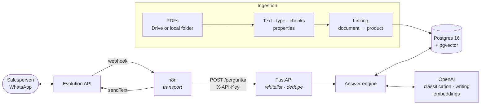
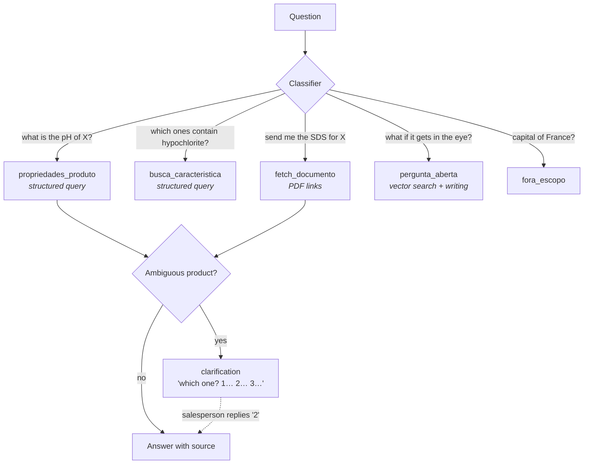
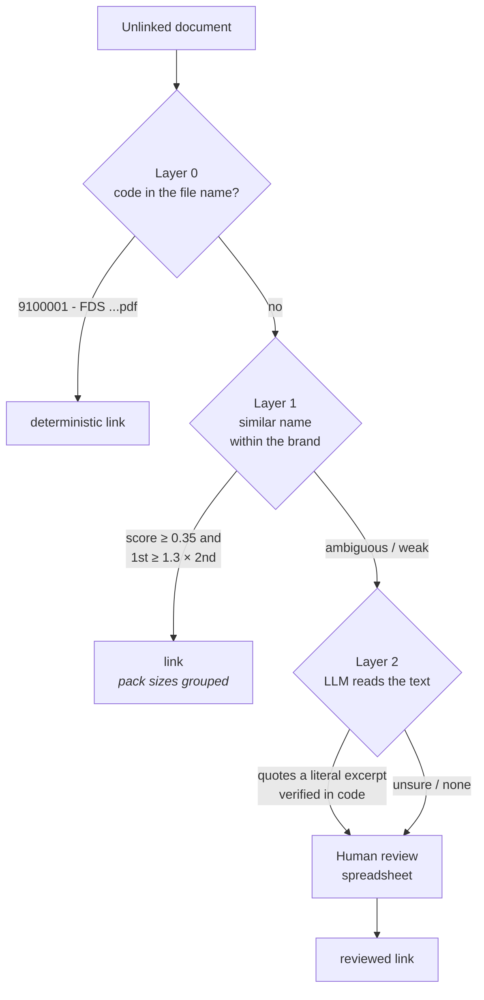

# Technical Data Sheet Bot

A WhatsApp assistant for **the sales team of a cleaning and hygiene
products distributor**. A salesperson asks in natural language and the
bot answers from the manufacturers' technical data sheets (TDS, "FT") and
safety data sheets (SDS, "FDS"), citing the source and sending the PDF
when asked.

```
Salesperson: qual o pH da água sanitária Limpax?
             (what is the pH of Limpax bleach?)
Bot:         AGUA SANITARIA LIMPAX 1L (LIMPAX) — código 9000001:
             - pH: 10 - 13
             Conforme FDS de Agua Sanitaria Limpax.
             (per the Limpax bleach SDS)
```

> **This is a sample repository.** The system runs for a real client;
> here the catalog, brands, companies, documents and product codes are
> **made up** (the `demo/` folder). The code, the architecture and the
> decisions are the real ones.
>
> The bot serves Brazilian salespeople, so its prompts, answers, code
> comments and operational docs are in Portuguese. Examples below are
> shown as the bot produces them, with a translation where it helps.

[](https://github.com/Renan-Maciel-Santos/bot-fichas-tecnicas/actions/workflows/testes.yml)

---

## Run the demo (≈ 5 minutes)

You need Docker and an OpenAI key. Loading the demo costs a few cents.

```bash
git clone https://github.com/Renan-Maciel-Santos/bot-fichas-tecnicas.git
cd bot-fichas-tecnicas

deploy/gerar_env.sh          # creates .env with every password generated
nano .env                    # fill in OPENAI_API_KEY

deploy/instalar.sh           # starts Postgres, API, n8n and Evolution; empty schema
demo/carregar_demo.sh        # catalog + 10 fictional PDFs through the real pipeline

# "what is the pH of Limpax bleach?"
demo/perguntar.sh "qual o pH da agua sanitaria limpax?"
# "send me the SDS for the eucalyptus disinfectant"
demo/perguntar.sh "me manda a FDS do desinfetante de eucalipto"
# "what should I do if hand sanitizer gets in someone's eye?"
demo/perguntar.sh "o que fazer se o alcool gel cair no olho?"

# "send me the SDS for the Limpax disinfectant" — 3 fragrances: it asks which one
demo/perguntar.sh "me manda a FDS do desinfetante limpax"
demo/perguntar.sh "3"        # and understands the choice
```

`perguntar.sh` calls the API the way n8n would when a message arrives
from WhatsApp. Connecting a real WhatsApp number is covered in
[`docs/DEPLOY_VPS.md`](docs/DEPLOY_VPS.md) (steps 7 to 9).

---

## Architecture



**n8n only transports.** Who may ask (whitelist), repeated messages
(dedupe by `message_id`) and what to answer all live in the API, so
switching channels does not move the rules somewhere else.

Everything starts from `docker-compose.yml`: Postgres, API, Evolution
and n8n, **each with its own database and role**, with no cross
privileges:

| Database | Role | Contents |
|---|---|---|
| `bot_fichas` | `bot_app` (read-only on the document base) · `botuser` (maintenance) | products, documents, chunks, query log |
| `n8n_bot` | `n8n_user` | workflow, credentials, executions |
| `evolution_bot` | `evolution_user` | WhatsApp instance |

### The answer engine

A classifier (an LLM with structured output) decides the intent; each
intent has its own path, and **only open questions go through RAG**:



- **Never answers without a source.** Every answer cites the document;
  with no document, it says it found nothing.
- **Ambiguity becomes a question.** "Bleach" with three brands in the
  catalog returns a numbered list; the conversation state (15 min)
  understands the "2" that comes next.
- **Explicit distrust.** Every answer reminds the salesperson to check
  critical information in the original sheet before passing it on to a
  customer.

### Layered ingestion and linking

The core problem is not the LLM: it is knowing **which product each PDF
belongs to**. Supplier file names are inconsistent, and a wrong link
sends the safety data sheet of the wrong product.



What each layer taught, measured against a golden set labeled by the
client's specialist (`scripts/eval_camada1.py`, `scripts/eval_camada2.py`):

- **Layer 1 (trigram).** The golden set would have accepted a looser
  threshold, doubling coverage with no errors. A simulation over the
  whole database, outside the sample, showed the opposite: below 0.35
  the trigram matches "Limpador Perfumado" (scented cleaner) with
  "Álcool Perfumado" (scented alcohol) — it compares letters and does
  not know that a gel and a liquid are different products. The
  threshold stayed; the gain came from **grouping pack sizes** (an SDS
  with no size in its name covers both 500 mL and 1 L) without grouping
  what defines the product (70x50 cm, 0.025 mm, 70°).
- **Layer 2 (LLM).** It receives the brand's catalog as a **closed
  list** and must quote, for each product, a **literal excerpt** from
  the PDF, which the code verifies; any deviation becomes "unsure".
  With that, precision went from 74% (`gpt-4o-mini`) to 90–92%
  (`gpt-5.5`).
- **Nothing from the LLM reaches the salesperson on its own.** The bot
  sends every linked document, so Layer 2 links go to a review
  spreadsheet (`scripts/conferencia_llm.py`) and only the ones marked
  correct enter the database.

The demo exercises every layer: code in the file name, similar name,
grouped pack sizes, an SDS that only its text reveals to cover three
fragrances, a filtered-out operating permit and a brand missing from
the catalog.

---

## Engineering decisions

| Decision | Why |
|---|---|
| **Least-privilege role** (`bot_app`) for the API | It reads the document base and writes only the query log; ingestion and maintenance run as `botuser`. |
| **Idempotency by `message_id`** | WhatsApp resends webhooks; the API records the id before calling the LLM and releases it if the engine fails, so the resend counts. |
| **Order of the barriers** in the API | Whitelist and dedupe are cheap local queries; an unauthorized number never spends OpenAI quota. |
| **Soft delete** on documents and products | `revogado_em` and `substituido_por_id` instead of `DELETE`; no bot query returns a revoked document. |
| **Ports on loopback only** | On a VPS, Docker bypasses the firewall; nothing is exposed, and the admin panels are reached through an SSH tunnel. |
| **Pinned images** (n8n, Evolution) | A silent `pull` changes the version and runs migrations by itself. |
| **`N8N_ENCRYPTION_KEY` declared** | Without it n8n hides an auto-generated key in the volume: lose the volume, lose the credentials. |
| **Versioned golden sets** (`tests/golden/`) | A change of threshold, prompt or model goes through an eval first; nothing is tuned by eye. |
| **CI with a fake OpenAI key** | Tests mock the LLM; a test that calls the real API fails in CI instead of spending money. |

---

## Layout

```
src/
  api/            FastAPI: /perguntar route, whitelist, dedupe
  query/          engine: classifier, structured and vector search,
                  conversation context, citation, writing
  ingestion/      PDFs (Drive or local folder) and catalog (spreadsheet)
  link_documents.py      linking, Layers 0 and 1
  link_llm.py            linking, Layer 2
  process_chunks.py      chunks + embeddings
  process_extraction.py  structured properties (pH, active ingredient, CAS…)
db/
  migrations/     versioned schema
  provisioning/   databases, roles and grants
deploy/           install, generate .env, export the document base, backup
demo/             fictional catalog and PDFs + demo scripts
n8n/workflows/    WhatsApp → API → WhatsApp workflow
scripts/          evals, review rounds with the client, WhatsApp setup
tests/            unit and integration (real database, rollback)
docs/             VPS deployment and operations runbook
```

## Tests

```bash
pip install -r requirements-dev.txt
pytest                         # everything (needs the compose Postgres)
pytest -m "not integration"    # unit tests only, no database
python -m scripts.eval_motor   # engine golden set (calls OpenAI)
```

CI (GitHub Actions) builds an empty database the same way
`deploy/instalar.sh` does — extensions, roles, migrations and grants —
and runs the whole suite on every PR. On the demo data, `eval_motor`
passes all 7 golden cases.

## Known limitations

- **Properties only from single-product documents.** An SDS that covers
  several fragrances is sent for all of them, but does not feed "what is
  the pH of X?": extraction only stores properties from a document
  linked to exactly one product, so one product is never credited with
  what was measured on another.
- **A brand missing from the catalog never links.** A Drive folder whose
  brand the catalog does not have stays out of every layer and goes to
  human review (`scripts/conferencia_rodada2.py`).
- **Bad OCR, bad answer.** Scanned PDFs become text through OCR, and the
  engine cannot tell that a number came through corrupted; hence the
  reminder to check the original sheet.

## Deployment and operations

Both documents are in Portuguese.

- [`docs/DEPLOY_VPS.md`](docs/DEPLOY_VPS.md) — from a fresh VPS to the
  bot answering on WhatsApp: firewall, `.env`, loading the document
  base, pairing, backup.
- [`docs/RUNBOOK_OPERACAO.md`](docs/RUNBOOK_OPERACAO.md) — diagnosis by
  symptom ("the salesperson sent a message and nothing came back").

## Stack

Python 3.12 · FastAPI · PostgreSQL 16 + pgvector · pg_trgm · OpenAI
(embeddings, classification, extraction, writing) · n8n · Evolution API ·
Docker Compose · GitHub Actions · pytest

## License

[MIT](LICENSE). The data in the `demo/` folder is fictional.
